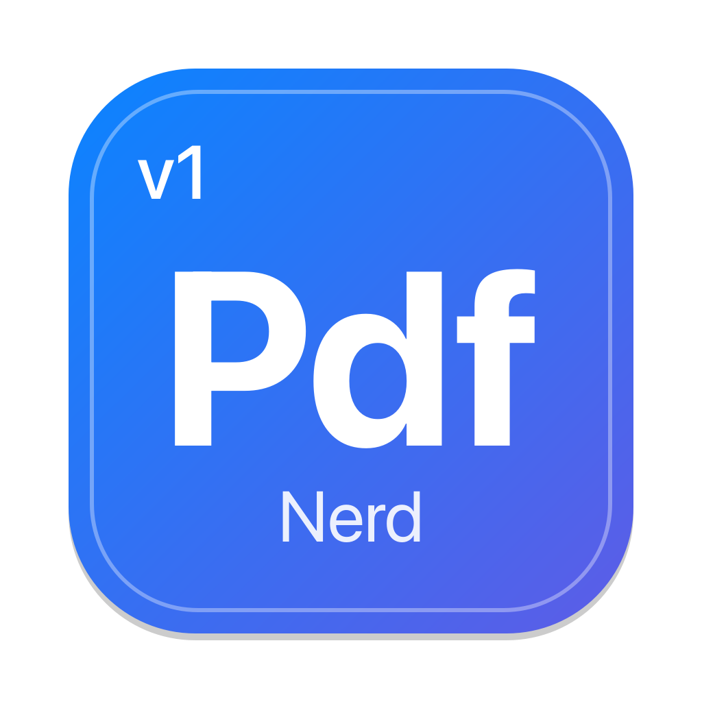
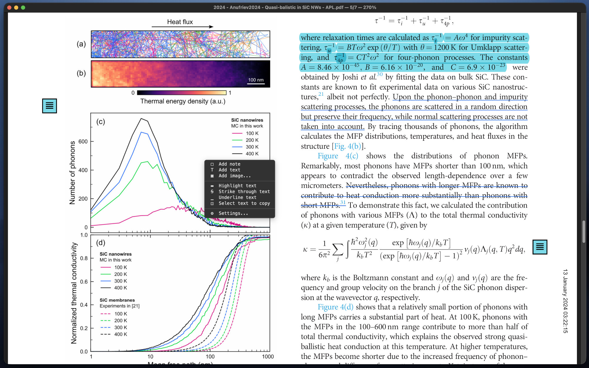

# NerdPDF

Minimal keyboard-driven PDF and image viewer.

- Supports Vim keys
- Opens PDF files and images alike
- Can add notes, text, images (e.g. signatures), highlights etc to PDF documents
- Can measure lengths, angles and radii in PDFs and images, in real units after setting a scale
- Smart defaults depending on PDF type (slide or document)
- Can view all images in the folder

## Installation

    pipx install git+https://github.com/anufrievroman/nerdpdf

On macOS, also add it to Applications (Spotlight, Dock, Finder's "Open With"):

    nerdpdf --install-app

## Usage

    nerdpdf file.pdf
    nerdpdf picture.png
    nerdpdf -h        # options and keys
    nerdpdf -v        # version

## Keys

| Key | Action |
| --- | --- |
| `j` / `k` (↓ / ↑) | scroll down / up |
| `h` / `l` (← / →) | scroll left / right |
| `J` / `K`, `n` / `p` | next / previous page (`n` steps through matches while a search is open) |
| `Space` / `Backspace` (`Shift+Space`) | next / previous page |
| PgDn / PgUp | scroll one screen |
| `gg` / `G`, Home / End | first / last page; `12G` or `12gg` goes to page 12 |
| `a` / `s` | fit width / fit page |
| `d` | toggle single-page mode (one page on screen) / continuous feed |
| `=` (`+`) / `-` | zoom in / out |
| middle-button drag | pan the document |
| right button + wheel, Shift+wheel, Cmd/Ctrl+wheel, pinch | zoom at the cursor |
| right-click | PDFs: add a note, text or image there, or highlight / strike through / underline / copy text; Settings; on an existing one only edit / delete it (marked text: delete the marks; images: bigger / smaller) |
| right-click → Measure | PDFs and images: Set scale (draw a line of known length, type its real length), then Measure length / angle / radius by dragging (Shift = 45° steps; an angle takes a drag for the first arm and a click for the second). Drag a handle or the line to edit; the scale line can be changed and everything follows. Right-click a measurement to delete it, `Esc` or right-click cancels / leaves the tool. Measurements are not saved in the file |
| Shift + left-drag | PDFs: select text and copy it to the clipboard |
| left-drag on a note, text or image | move it |
| left-drag on an image's bottom-right corner | resize it |
| double-click on a note or text | edit it |
| hover over a note | show its text |
| `/` | search: Enter finds, then `n` / `N` = next / previous match, Esc = close |
| `R` | invert colors (white becomes a dark color, set in Settings; black becomes white); not for images |
| `f` / `F` | toggle fullscreen; `Esc` leaves it (after closing search, if open) |
| `o` | open file (drag & drop works too) |
| `q` | quit |
